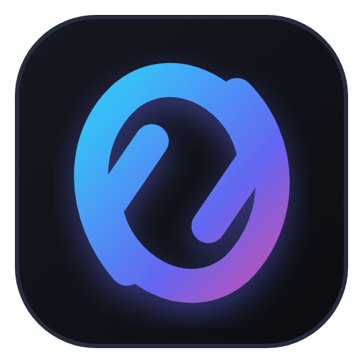
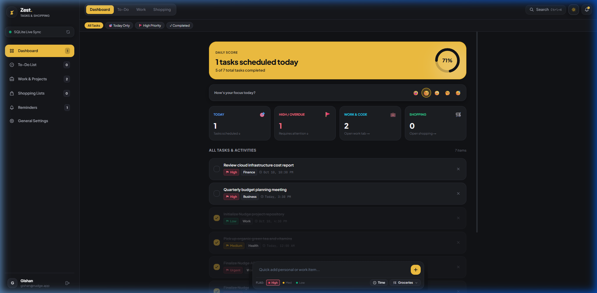
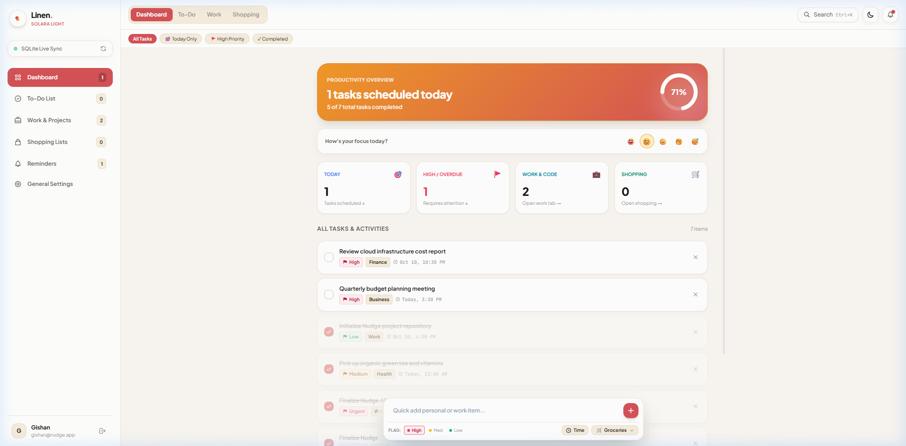

  

<h1 align="center">Nudge Planner</h1>

  <strong>Remember Less. Get More Done.</strong> 
  <em>A minimalist, hyper-productive task ecosystem for Web, Mobile, and Windows 11.</em>

  
  
  
  

  <a href="https://todo.premiumbayy.com"><strong>🚀 Open Web App</strong></a> •
  <a href="https://github.com/zatokaa/nudge/releases/latest/download/Nudge.exe"><strong>⬇️ Download Windows App</strong></a> •
  <a href="#-key-features">Features</a> •
  <a href="#-desktop-companion-setup">Desktop Setup</a> •
  <a href="#-ultra-low-ram-architecture-5065-mb">Low RAM Spec</a> •
  <a href="#-theme-system">Themes</a>

---

> [!TIP]
> ### 🌐 Cloud Service & Client Hub
> Nudge is an official productivity suite powered by **[PremiumBayy](https://www.premiumbayy.com)**.
> - **Web Application:** Access your planner from any browser at **[todo.premiumbayy.com](https://todo.premiumbayy.com)**.
> - **Windows 11 Companion:** Download the standalone portable mini-widget below to sync tasks straight to your desktop.

---

## 🌟 Visual Showcase

  
<strong>☀️ Warm Linen (Solara Light Mode)</strong>

  
    
  
<strong>🌙 Charcoal Onyx (Zest Dark Mode)</strong>

  

---

## ✨ Key Features

- **⚡ Instant Natural Language Parser (NLP):** Type `"Dentist appointment tomorrow 10am #urgent"` and Nudge automatically infers due dates, times, and priority flags.
- **📋 Work Task Checklists & Shopping Bullets:** 
  - **Work Section:** Structure complex projects with subtasks, checklist indicators, and progress tracking.
  - **Shopping Section:** Rapid list creation with bullet items and one-tap cross-offs.
- **🛡️ Accidental-Click Safeguard:** Clicking completed items prompts a safeguard confirmation to prevent accidental disruptions.
- **🎨 5 Curated First-Class Themes:** Standalone, zero-FOUC themes that seamlessly synchronize across devices (*Warm Linen, Emerald Pure, Zest Gold, Slate Pro, Midnight OLED*).
- **🔑 Google 1-Click Sign-In & Secure Authentication:** Fast, passwordless login powered by Google OAuth 2.0 with isolated user data.
- **💻 Windows 11 Desktop Mini-Widget:** Lightweight floating companion that snaps to your desktop tray. Syncs automatically every 30 minutes with an ultra-low ~50–65 MB memory footprint.
- **📱 PWA Ready:** Installable as a standalone app on iOS Safari, Android Chrome, and macOS with offline support.

---

## 💾 Direct Download for Windows

The Windows client is a **zero-install portable single-file executable**. No installer or runtime setup required:

👉 [**Download Nudge.exe (v1.0.2 for Windows 11 / 10)**](https://github.com/zatokaa/nudge/releases/latest/download/Nudge.exe)  
*(~75 MB, Portable Single Executable, Windows 11 & 10)*

View all releases and historical changelogs on the [**GitHub Releases Page**](https://github.com/zatokaa/nudge/releases).

---

## 🔌 Windows Desktop Companion Setup

Connecting your desktop mini-widget to your cloud account takes less than 30 seconds:

1. **Sign In to the Cloud:**
   Open **[todo.premiumbayy.com](https://todo.premiumbayy.com)** in your browser and sign in (via Google or Email).
2. **Copy Your Personal API Token:**
   Navigate to **Settings > Account Profile** and click **"Copy Token"** under the *Personal API Bearer Token* section.
3. **Launch `Nudge.exe` on Windows:**
   Double-click `Nudge.exe`. Click the **Settings (⚙️)** icon on the widget header.
4. **Paste and Connect:**
   - **Server URL:** Pre-configured to `https://todo.premiumbayy.com` (leave as default).
   - **API Bearer Token:** Paste your copied token.
   - Click **Save & Connect**.
5. **Done!** Your desktop widget will automatically synchronize with your cloud account **every 30 minutes** (or immediately on manual refresh).

---

## 🪶 Ultra-Low RAM Architecture (~50–65 MB)

Most Electron apps consume **350 MB to 800 MB+** of memory. Nudge was engineered from the ground up to run like a native Windows utility:

| Metric | Typical Desktop Apps (Slack, Notion, Teams) | Nudge Desktop Mini-Widget |
| :--- | :--- | :--- |
| **Idle Memory (RAM)** | 350 MB – 800 MB+ | **~50 MB – 65 MB** ⚡ |
| **Background Processes** | 5 – 8 processes | **1 isolated process** |
| **V8 Heap Cap** | Unlimited (bloats over time) | **`--max-old-space-size=64`** |
| **GPU Acceleration** | Enabled (heavy VRAM drain) | **Disabled for lightweight efficiency** |
| **Auto-Sync Frequency** | Constant polling (battery drain) | **Optimized every 30 minutes** |
| **Gaming & Compiling Impact** | Noticeable FPS drops / RAM hog | **Virtually undetectable** |

---

## 🎨 Theme System

| Palette | Type | Primary Accent | Canvas Tone | Best For |
| :--- | :---: | :---: | :---: | :--- |
| **🌾 Warm Linen (Solara)** | ☀️ Light | Terracotta & Coral (`#D45256`) | Organic Warm Cream (`#FAF7F2`) | Daytime deep focus |
| **🌿 Emerald Pure (Mint)** | ☀️ Light | Vibrant Forest Emerald (`#059669`) | Crisp Porcelain White (`#FAFCFA`) | Calm productivity |
| **⚡ Zest Gold** | 🌙 Dark | Amber Sunburst (`#F59E0B`) | Charcoal Onyx (`#0A0A0B`) | High-contrast night |
| **💎 Slate Pro** | 🌙 Dark | Apple iOS Royal Blue (`#3B82F6`) | Deep Slate Glass (`#0F172A`) | Technical workflows |
| **🌌 Midnight OLED** | 🌙 Dark | Electric Indigo (`#6366F1`) | True Pitch Black (`#000000`) | Battery saver & OLED |

---

## 📄 License & Ownership

Copyright &copy; 2026 **[PremiumBayy](https://www.premiumbayy.com)**. All Rights Reserved.

This software, source code, design, and associated assets are proprietary. Unauthorized copying, distribution, modification, reverse engineering, or commercial use without prior written authorization is strictly prohibited.

For support or enterprise inquiries, visit **[www.PremiumBayy.com](https://www.premiumbayy.com)**.
